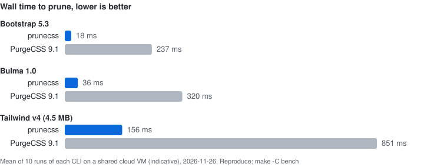

# Benchmarks

prunecss is compared with **PurgeCSS 9.1.0** on real stylesheets: speed,
memory, output size and, most importantly, which CSS each tool keeps. The
harness, the pinned corpora and the raw data are in [`bench/`](bench/);
[bench/README.md](bench/README.md) explains every measurement.



## Summary

Latest run: [results/2026-11-26-vm.md](bench/results/2026-11-26-vm.md),
7 corpora, 10 timed runs each after 3 warm-ups, prunecss at commit
`a66faef`.

| | prunecss compared with the PurgeCSS CLI |
|---|---|
| Wall time | **5.4–24.4× faster** (median 9.0×) |
| vs PurgeCSS's JS API in a warm process | 2.3–5.7× faster (median 3.9×), for prunecss's whole CLI run |
| Peak memory | PurgeCSS used 1.5–8.1× as much |
| Possible false removals (static DOM) | **prunecss 0 on every corpus**; PurgeCSS 376 on Tailwind with its default extractor, 1 with the Tailwind extractor, 5 on the hand-written edge cases |
| Output size | PurgeCSS's output is smaller, mostly because prunecss always keeps tag and attribute selectors. prunecss's extra bytes after brotli: 0.2 kB on Bootstrap, 0.1 kB on Bulma, 2.7 kB on Tailwind, up to 4.2 kB on the synthetic corpora; after gzip: 0.2, 5.7, 3.9 and up to 5.0 kB |

## How to read these numbers

- **Indicative, not definitive.** They come from a shared cloud VM. Run the
  suite on your own machine before quoting them.
- **Same inputs for both tools.** Each tool gets the same stylesheet, the
  same content files and the same empty safelist, and every output is
  checked for success and a non-empty result before anything is timed.
- **Correctness comes first.** A tool that removes more CSS looks smaller and
  sometimes faster. Each output is compared selector by selector and checked
  against a static-DOM oracle, so a smaller output that breaks the page is
  reported as a false removal, not a win.
- **The warm-API row favours PurgeCSS.** It times only PurgeCSS's in-process
  work with inputs preloaded, against prunecss's entire CLI run including
  process start and file reads.

## Reproduce

Requirements: Node 22+, a Rust toolchain, `curl` and, ideally, GNU time.

```bash
make -C bench
```

This installs the pinned tools, downloads the corpora and checks their
hashes, builds prunecss in release mode, runs everything and writes
`bench/results/<date>-<host>.{json,md}`. Redraw the chart with
`node bench/scripts/chart.mjs bench/results/<file>.json assets/benchmark.svg`.

Rust micro-benchmarks (criterion, no corpus needed):

```bash
cargo bench -p prunecss-core
```
