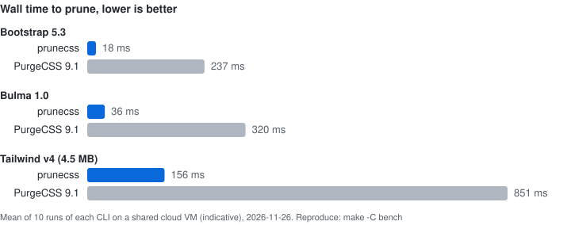

# prunecss

**Remove unused CSS, fast.** A Rust alternative to
[PurgeCSS](https://github.com/FullHuman/purgecss): it scans your HTML, JSX and
templates for the class names they use, then removes the CSS rules that can
never match.

[](https://github.com/Anikhet/prunecss/actions/workflows/ci.yml)
[](https://crates.io/crates/prunecss)
[](https://docs.rs/prunecss-core)
[](Cargo.toml)
[](#license)

<p align="center">
  
</p>

- **5–24× faster than the PurgeCSS CLI** (median 9×) on real and synthetic
  stylesheets, while PurgeCSS used 1.5–8× as much memory. See
  [BENCHMARKS.md](BENCHMARKS.md).
- **Errs on the side of keeping CSS.** On the benchmark corpora prunecss
  removed nothing a static page needs; PurgeCSS's default extractor removed
  376 such rules on Tailwind.
- **Drop-in options.** `prunecss.json` uses PurgeCSS's option names, with a
  JSON Schema for editor autocompletion.
- **Built for CI.** `--check` fails the build when CSS is unused, `--json`
  gives a machine-readable report, and exit codes are stable.
- **Understands modern markup.** Tailwind-style names (`md:flex`, `w-1/2`,
  `w-[10px]`), JSX, Vue, Svelte, Astro and Angular class syntax.

[Install](#install) · [Usage](#usage) · [FAQ](FAQ.md) ·
[Benchmarks](BENCHMARKS.md) · [Changelog](CHANGELOG.md) ·
[Architecture](ARCHITECTURE.md) · [Contributing](CONTRIBUTING.md)

> **Status: early development (0.x).** Review the output before shipping it,
> and [report anything wrongly removed](https://github.com/Anikhet/prunecss/issues/new?template=false_removal.yml).

## Install

With Rust 1.88 or newer (from [rustup](https://rustup.rs/)):

```bash
cargo install prunecss --locked
```

Or download a prebuilt binary for Linux, macOS or Windows from the
[latest release](https://github.com/Anikhet/prunecss/releases/latest); each
comes with a build provenance attestation.

## Usage

Prune one stylesheet against your source files (quote globs so the shell
doesn't expand them):

```bash
prunecss prune dist/app.css --content 'src/**/*.{html,jsx,tsx,vue,svelte,astro}' -o dist/app.pruned.css
```

Or put the settings in a `prunecss.json` at the project root and just run
`prunecss prune`. prunecss looks for the file in the current directory and
its parents; paths in it are relative to the file. Option names follow
PurgeCSS, and the JSON Schema gives your editor autocompletion:

```json
{
  "$schema": "https://raw.githubusercontent.com/Anikhet/prunecss/main/prunecss.schema.json",
  "css": ["dist/**/*.css"],
  "content": ["src/**/*.{html,jsx,tsx,vue,svelte,astro}", "index.html"],
  "output": "dist/pruned/",
  "safelist": { "standard": ["/^is-/"], "greedy": ["/^swiper/"] },
  "keyframes": true,
  "minify": true
}
```

Unknown keys are an error, so a typo can't silently change what is removed.
Command-line flags override the file: each on/off setting has a `--no-*` form
(`--no-minify`, `--no-keyframes`, …) to turn off what the file turns on, and
when you name stylesheets on the command line only `-o` decides where the
result goes. `--no-config` ignores the file.

| Task | Command |
|---|---|
| Prune and print to stdout | `prunecss prune app.css -c 'src/**/*.{html,tsx}'` |
| Several stylesheets into a directory | `prunecss prune 'dist/*.css' -c src -o dist/pruned/` |
| Read CSS from a pipe | `cat app.css \| prunecss prune - -c src` |
| CI check: fail if anything is unused | `prunecss prune --check` |
| Machine-readable summary | `prunecss prune --check --json` |
| What names does my code use? | `prunecss scan 'src/**/*.{html,tsx}' --css dist/app.css` |
| Shell completions | `prunecss completions bash` (also zsh, fish, …) |

Globs respect `.gitignore` (`--no-gitignore` turns that off); files you name
directly are always used. Point `--content` at templates and scripts, not at
stylesheets: a class mentioned in a CSS file would count as used. **If the
content patterns match no files at all, prunecss refuses to run**, because
every class would look unused.

prunecss never writes over a stylesheet or content file it reads, including
through symlinks and hard links; such a run stops before writing anything.

Exit codes: `0` success, `1` `--check` found CSS that would be removed,
`2` any error.

## How it decides what to remove

A selector is kept when every class and id it needs appears somewhere in the
content files. This is the same conservative "bag of names" model PurgeCSS
uses. To avoid breaking pages, prunecss **never** removes CSS because of:

- tags, attributes, combinators (`>`, `+`, `~`) or pseudo-classes such as
  `:hover`, `:focus` and `::before`;
- anything inside `:not()`, `:has()` or `:nth-child(… of …)`;
- `@keyframes`, `@font-face` or custom properties, unless you opt in (see
  below), and never `@property`;
- named `@layer` blocks, even empty ones, because they fix the cascade order.

It does:

- remove single selectors from lists, so `.used, .unused {}` becomes `.used {}`;
- match escaped names such as `.md\:flex`, `.w-1\/2` and `.w-\[10px\]`;
- prune inside `@media`, `@supports`, `@container`, `@scope` and
  `@starting-style`, and drop those blocks once they are empty;
- remove nested rules together with their parent.

### Finding class names

prunecss does not parse your templates. It splits every content file into
candidate names, the approach Tailwind's own scanner uses, so it finds names
in HTML, JSX/TSX (`className`, `clsx(...)`, template literals, object keys),
Vue (`:class`), Svelte (`class:active`), Astro (`class:list`), Angular
(`[ngClass]`), CSS modules (`styles.button`) and DOM calls such as
`classList.add("open")`. Tailwind-style names stay whole: `md:flex`, `w-1/2`,
`!mt-0`, `grid-cols-[repeat(auto-fill,minmax(0,1fr))]`.

Over-collecting is deliberate. A candidate that isn't a real class keeps no
CSS, but a missed one would delete CSS the page needs.

### Safelist

Class names assembled at runtime, such as `` `btn-${size}` ``, cannot be
found by any static scanner. Safelist them, using an exact name or a
`/regex/`:

```bash
prunecss prune styles.css --content src/App.jsx \
  --safelist /^btn-/ \
  --safelist-greedy /^swiper/ \
  --safelist-deep prose
```

- `--safelist` treats a matching class or id as used.
- `--safelist-greedy` keeps any selector that contains a match, such as
  `.swiper-slide .unused`.
- `--safelist-deep` also keeps every rule nested inside a matching selector.
- `--safelist-keyframes` and `--safelist-variables` protect names from the
  opt-in removals below.

### Unused keyframes, fonts and variables (opt-in)

Like PurgeCSS, these are kept unless you ask:

- `--keyframes` removes `@keyframes` that no kept rule names, including
  through `-webkit-animation`, the `animation` shorthand or a variable.
- `--font-face` removes `@font-face` rules whose family no kept rule names,
  including through the `font` shorthand.
- `--variables` removes custom properties that nothing reads through
  `var()`, following chains such as `--brand: var(--base)`.

Content files count as references for all three, so an animation, font or
variable used from JavaScript is kept.

### Known limits

- Output is reprinted by Lightning CSS, so some values change to an
  equivalent form (`white` becomes `#fff`, `::before` becomes `:before`).
  Printing is tuned for old browsers: colours stay `rgba()` rather than
  8-digit hex, media queries keep the `min-width` form, nesting is never
  flattened, and `@charset "UTF-8"` is added when the output needs it.
- Rules the parser can't read (`.a >>> .b`, `*zoom: 1` and similar hacks)
  are skipped, as browsers skip them. prunecss prints a warning with the
  file, line and column for each, and `--check` counts them as changes.
- A few values are normalised in ways that can matter: `translate3d(0,0,0)`
  prints as `translate(0,0)` (dropping the "GPU layer" hack), colour alpha is
  rounded to two decimals, and `(width > 600px)` prints as
  `not (max-width: 600px)`. If you rely on these, safelist won't help; keep
  those rules in a stylesheet you don't prune.
- Fuzzing found that Lightning CSS's printer can merge tokens in unusual
  custom-property and unknown-property values that have no space between
  them: `--x:1+2px` prints as `--x:12px`, and `--y:a/**/b` as `--y:ab`.
  Values written with normal spacing (`1 + 2px`, `calc(...)`) are not
  affected. Details: [fuzz/regressions](fuzz/regressions/README.md). A
  future version will keep the original bytes of every kept rule instead
  of reprinting them.

## Contributing

Bug reports, ideas and pull requests are welcome. Please read
[CONTRIBUTING.md](CONTRIBUTING.md) first; for larger changes, open an issue
before writing code. [ARCHITECTURE.md](ARCHITECTURE.md) gives a short tour of
the code, and [docs/adr/](docs/adr/) records the main design decisions.

prunecss is built with AI assistance (Claude Code), and every change is
reviewed and tested by the maintainer; see [AI_POLICY.md](AI_POLICY.md).
It is maintained by one person in their spare time; expect replies within
one to two weeks.

- Questions: see [SUPPORT.md](SUPPORT.md)
- CSS wrongly removed? [Report a false removal](https://github.com/Anikhet/prunecss/issues/new?template=false_removal.yml)
- Security issues: see [SECURITY.md](SECURITY.md); please don't open a public issue
- Changes: see [CHANGELOG.md](CHANGELOG.md)
- Code of Conduct: [CODE_OF_CONDUCT.md](CODE_OF_CONDUCT.md)

## License

MIT or Apache-2.0, at your option.
